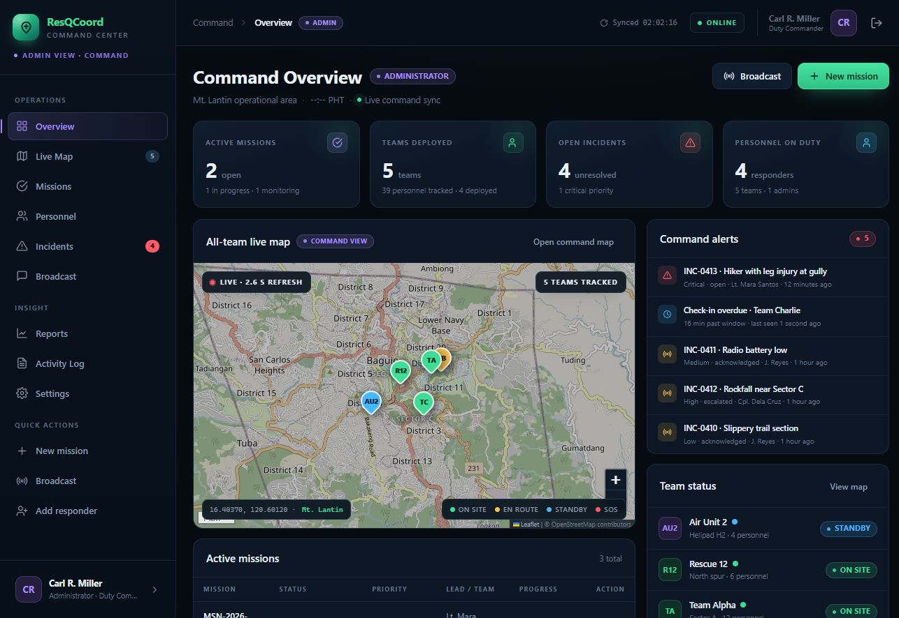
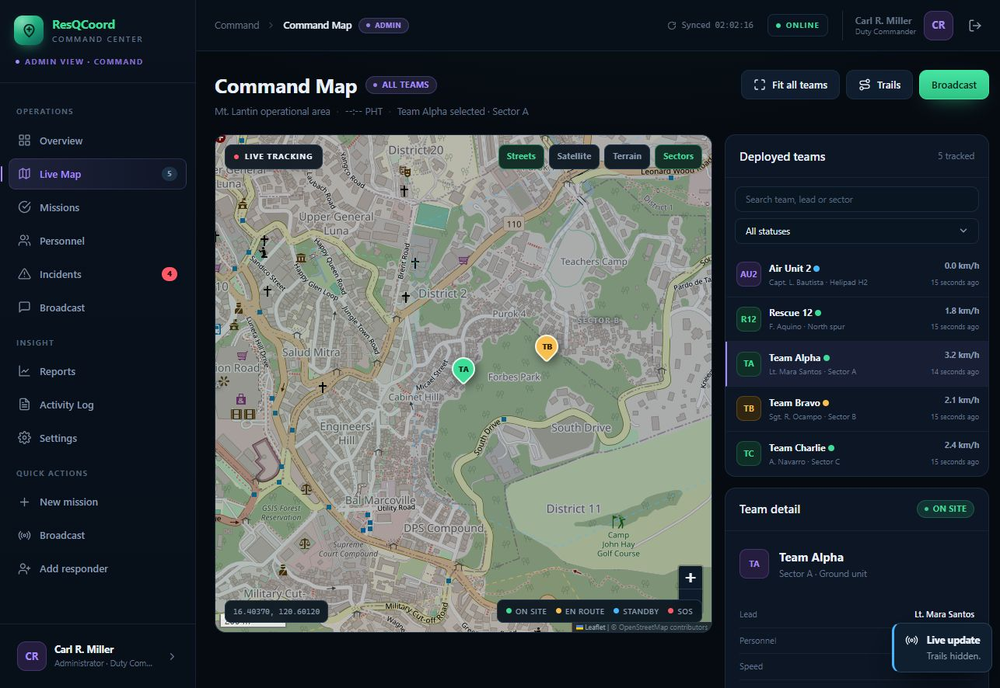
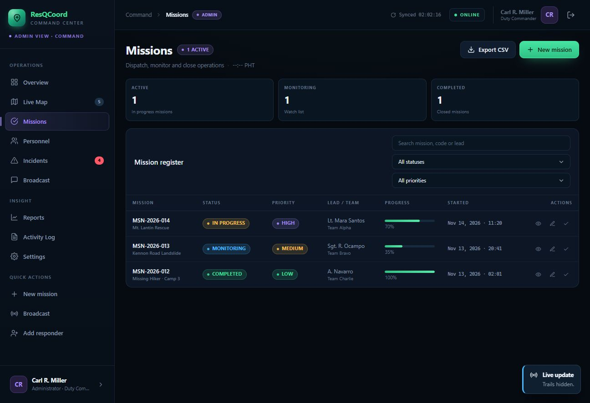
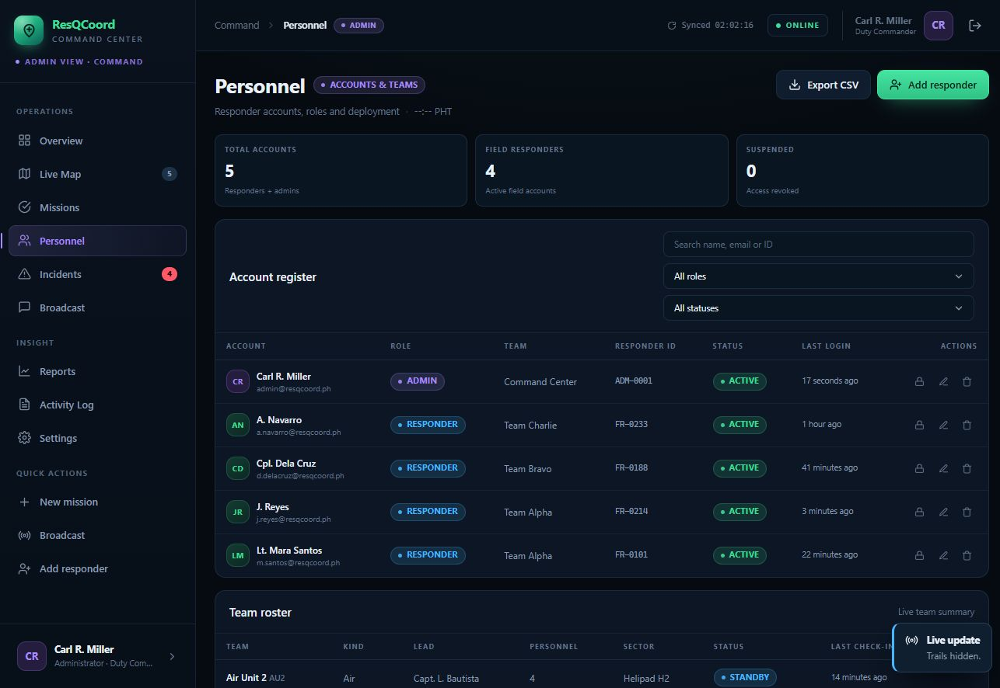
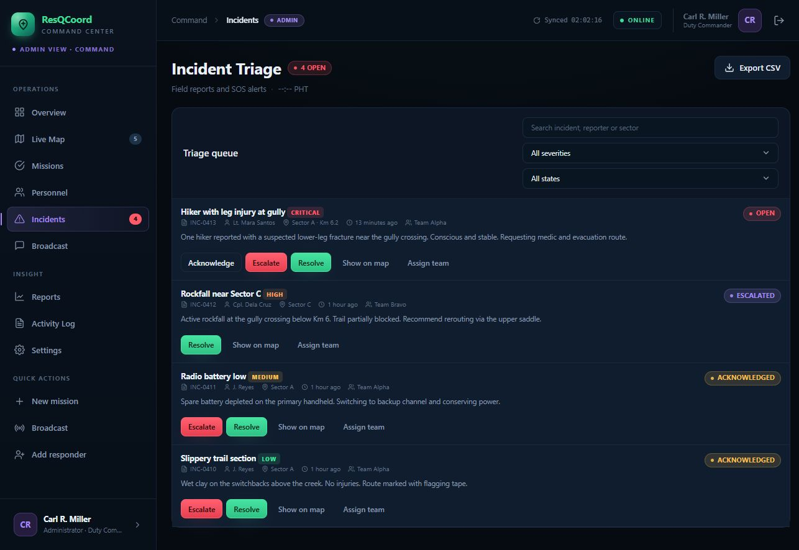
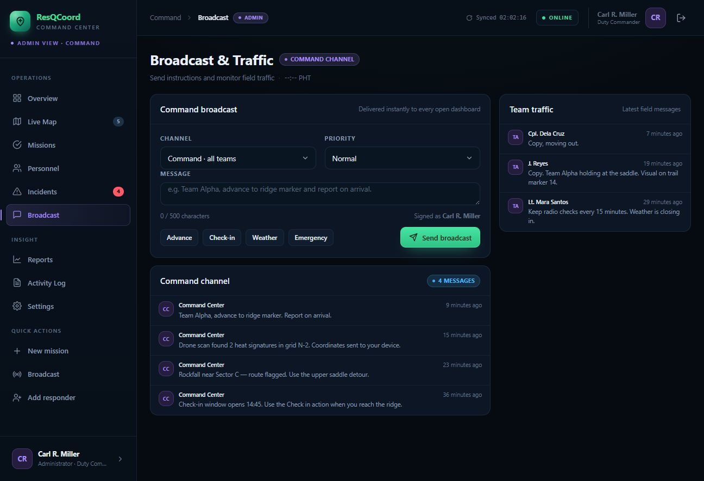
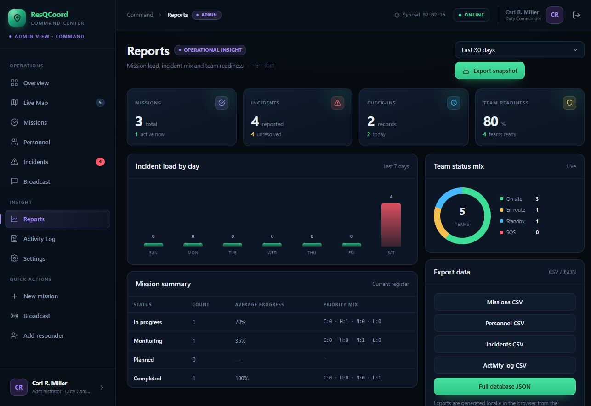
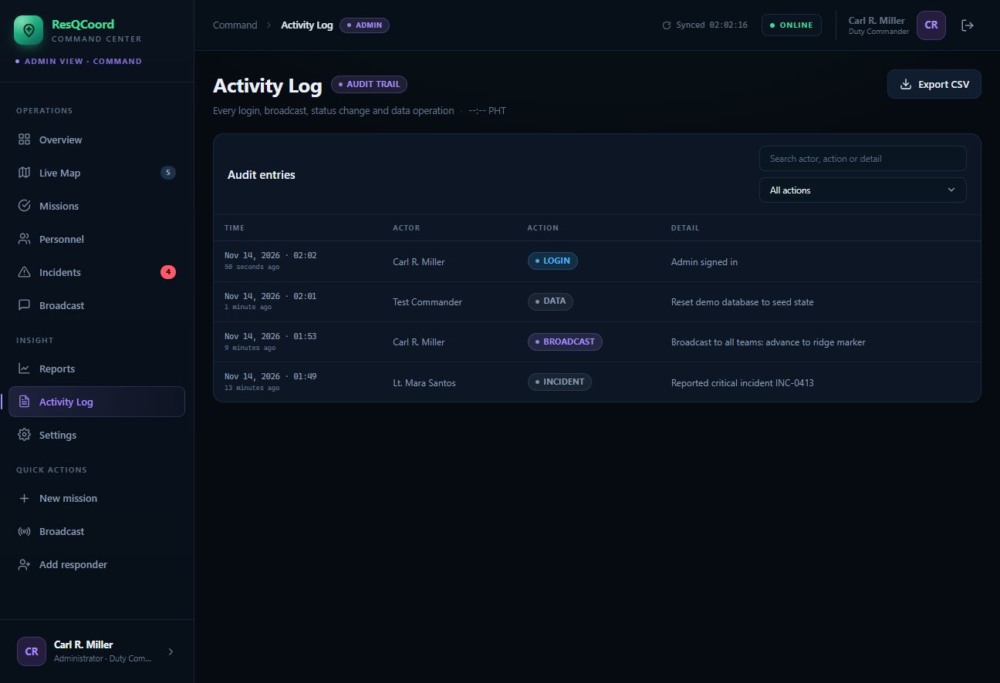
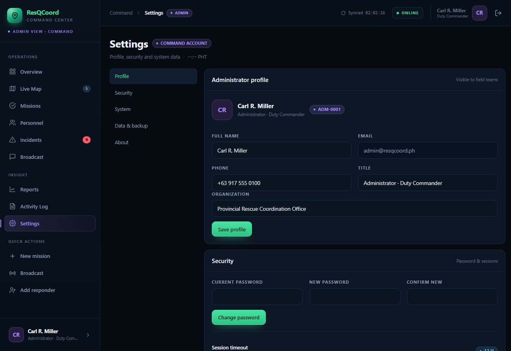
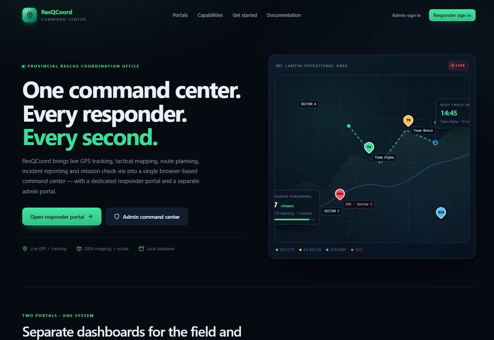

# ResQCoord — Rescue Coordination Command Center

A complete rescue command center built with **HTML, CSS, and JavaScript**, packaged as both a **browser app** and an **Electron desktop app**. It has two separate portals — a **responder field dashboard** and an **admin command dashboard** — with real login/registration, live GPS and map tracking, route planning, missions, incidents, broadcasts, reports, and a local database that persists everything between reloads.

No Python and no backend framework are required. The browser build uses a tiny zero-dependency Node static server; the desktop build wraps the same app in Electron.

> **Download the Windows app:** see this repository's **Releases** page for the portable `.exe` and installer. Desktop build instructions are in [DESKTOP.md](DESKTOP.md).



---

## 1. What is included

| Area | Features |
| --- | --- |
| **Responder portal** | Register, sign in, field dashboard, mission progress, live map, real GPS + demo patrol, route planner with turn-by-turn steps, route playback/navigation, check-in, SOS alert + clear, incident reports, command messages, profile and password settings |
| **Admin portal** | Register with access code, sign in, KPI overview, live all-team map, team selection/trails/route assignment, mission CRUD + progress advance, personnel create/edit/suspend/delete, incident acknowledge/escalate/resolve/assign, broadcasts + team traffic, charts and reports, CSV/JSON export, audit trail, system settings |
| **Live data** | IndexedDB database (localStorage fallback), seeded demo data, positions/trails, check-ins, missions, incidents, messages, audit log |
| **Maps** | Leaflet 1.9.4 (vendored locally), OpenStreetMap / Esri satellite / OpenTopoMap layers, sector overlays, team markers, trails |
| **Routing** | OSRM road routing and Nominatim geocoding when online, automatic curved offline fallback when offline |
| **Security model** | Separate role-guarded sessions, PBKDF2-SHA256 password hashing, suspended-account blocking, admin access code, audit logging |

Everything is client-side. The tiny `server.js` only serves static files so `http://localhost` gives you IndexedDB, geolocation, and Web Locks.

---

## 2. Quick start

### Option A — Windows desktop app (recommended)

Download the portable **`ResQCoord 1.0.0.exe`** or the installer from **Releases**, then run it. Node.js is not needed.

> The app is not code-signed, so Windows SmartScreen may warn once: **More info → Run anyway**.

### Option B — Desktop from source

```bat
npm install
npm start
```

Build a Windows installer and portable app with:

```bat
npm run dist
```

Output goes to `release\`.

### Option C — Browser version

```bat
node server.js
```

Open <http://localhost:3000>. Use a custom port with `node server.js 8080`.

### Option D — VS Code Live Server

1. Open this folder in VS Code.
2. Install the **Live Server** extension.
3. Right-click `index.html` → **Open with Live Server**.

> Do not open the HTML files directly with `file://`. The app still runs from `file://` using its localStorage fallback, but real GPS and PBKDF2 password hashing need `http://localhost` or HTTPS.

---

## 3. Demo accounts

| Portal | Email | Password | Role |
| --- | --- | --- | --- |
| Admin | `admin@resqcoord.ph` | `Admin@123` | Duty commander |
| Responder | `j.reyes@resqcoord.ph` | `User@123` | Team Alpha |
| Responder | `m.santos@resqcoord.ph` | `User@123` | Team Alpha lead |
| Responder | `d.delacruz@resqcoord.ph` | `User@123` | Team Bravo |
| Responder | `a.navarro@resqcoord.ph` | `User@123` | Team Charlie |

Admin registration requires the access code **`RESQ-ADMIN-2026`** (shown in the UI and in Admin → Settings).

Each portal rejects the other role:

- A responder trying to open the admin portal is redirected to the responder dashboard.
- An admin trying to sign in through the responder portal gets a clear error.

> Browsers share one local session per origin, so use one role at a time. To demonstrate both roles side by side, use a normal window for one portal and an incognito/private window for the other.

---

## 4. Portals and URLs

| Page | URL |
| --- | --- |
| Landing page | `http://localhost:3000/` |
| Responder login | `http://localhost:3000/user/login.html` |
| Responder registration | `http://localhost:3000/user/register.html` |
| Responder dashboard | `http://localhost:3000/user/dashboard.html` |
| Admin login | `http://localhost:3000/admin/login.html` |
| Admin registration | `http://localhost:3000/admin/register.html` |
| Admin dashboard | `http://localhost:3000/admin/dashboard.html` |

---

## 5. Guided walkthrough

### Responder journey

1. Sign in with `j.reyes@resqcoord.ph` / `User@123`.
2. The dashboard shows the deployed team, mission progress, next check-in window, and GPS status.
3. Open **Live Map**. The seeded team marker patrols its sector through the background simulation.
4. Click **Demo movement** to attach live positions to your account every 2.2 seconds. A toast confirms “Demo movement started”.
5. Click **Route**, choose a destination such as *Ridge Marker — Km 7.5*, then **Get route**. The map draws the OSRM route, shows distance, ETA, and turn-by-turn steps.
6. Click **Start navigation** to animate your marker along the route.
7. Click **Check in** (sidebar or dashboard), add a note, and send it. Command receives the position and status.
8. Open **Report Incident**, choose a type/severity, describe the hazard, and submit. A critical incident is created in the shared database and appears on the admin dashboard.
9. Use **SOS Alert** to set the team to emergency status, create a critical incident, and broadcast your position. Clear it from **Update status → Clear SOS**.
10. Open **Messages** and reply on the secure channel. Open **Settings** to edit your profile, set the check-in interval, and change your password.

### Admin journey

1. Sign in with `admin@resqcoord.ph` / `Admin@123`.
2. **Overview** shows live KPIs, readiness, SOS alerts, active missions, and recent activity.
3. **Live Map** shows all teams. Click a team card, then **Focus**, **Show trail**, or assign a destination and click **Route team**. The route and ETA are saved and drawn on the map.
4. **Missions** — create a mission with the **New mission** button, advance progress with the row action, edit details, and export CSV.
5. **Personnel** — add a responder account, edit details, suspend/reactivate, or delete. Suspended accounts cannot sign in.
6. **Incidents** — acknowledge, escalate, resolve (with a note), assign a team, or show the location on the map.
7. **Broadcast** — send a priority message to all teams or a single channel; the responder message feed receives it.
8. **Reports** — switch between 7/30/90 days and all data, view incident trends, and export missions/personnel/incidents/audit CSV or a full JSON database backup.
9. **Activity Log** — every login, broadcast, mission, incident, personnel, SOS, and data operation is recorded.
10. **Settings** — update the command profile, change the password, toggle simulation/SOS sound/strict check-in/accuracy, export the database, or reset the demo data.

---

## 6. Screenshots

| Admin overview | Admin live map |
| --- | --- |
|  |  |

| Missions | Personnel |
| --- | --- |
|  |  |

| Incidents | Broadcast |
| --- | --- |
|  |  |

| Reports | Activity log |
| --- | --- |
|  |  |

| Settings | Landing page |
| --- | --- |
|  |  |

---

## 7. How the database works

- **Primary engine:** IndexedDB database `resqcoord` (versioned stores).
- **Fallback:** a single localStorage record when IndexedDB is unavailable (for example, some `file://` contexts).
- **Stores:** `users`, `sessions`, `teams`, `missions`, `incidents`, `messages`, `checkins`, `positions`, `settings`, `audit`.
- **Persisted live data:** team coordinates, speed, heading, battery, trail points, check-ins, missions, incidents, messages, settings, and audit entries.
- **Seeding:** the first run creates five demo accounts, five teams with patrol routes, three missions, four incidents, seven messages, and check-ins.
- **Reset:** Admin → Settings → **Reset demo database** returns everything to the seeded state. Signed-in sessions are preserved when their account still exists.
- **Export:** JSON export contains every store; CSV exports cover missions, personnel, incidents, and the audit log.
- **Passwords:** PBKDF2-SHA256 with a per-user salt via Web Crypto. A deterministic fallback hash is used only when Web Crypto is unavailable under `file://`.

Storage is **per browser and per origin**. Clearing site data, using a different browser, or switching from `localhost:3000` to `localhost:8080` starts from a fresh seeded database.

---

## 8. Map, GPS, tracking, and routing

- **Leaflet 1.9.4** is vendored in `assets/vendor/leaflet`, so maps work without a CDN.
- **Tiles** load from OpenStreetMap, Esri World Imagery, and OpenTopoMap when online.
- **Background simulation:** every open dashboard runs a single simulation leader (Web Locks) that patrols teams and writes positions to IndexedDB. A BroadcastChannel plus a localStorage ping keeps other tabs in sync.
- **Real GPS:** **Use my GPS** calls `navigator.geolocation.watchPosition`. Browsers require permission and a secure context (`localhost` counts as secure).
- **Demo movement:** **Demo movement** moves your team every 2.2 seconds and stores each fix, so the feature works without location permission or hardware.
- **Routing:** OSRM (`router.project-osrm.org`) returns road geometry, distance, duration, and steps. If it is unreachable, the app draws a curved direct route and labels it “Offline fallback”.
- **Geocoding:** Nominatim search with preset Mt. Lantin places as a fallback.

---

## 9. Project structure

```text
resqcoord/
├─ index.html                 Landing page
├─ server.js                  Zero-dependency static server
├─ package.json               Electron + electron-builder configuration
├─ electron/main.js           Desktop entry; starts server and native window
├─ start.bat                  Browser launcher
├─ start-desktop.bat          Desktop launcher (installs Electron on first run)
├─ DESKTOP.md                 Desktop build notes
├─ README.md                  This file
├─ admin/
│  ├─ login.html              Admin sign-in
│  ├─ register.html           Admin registration (access code)
│  └─ dashboard.html          Admin command dashboard (9 views)
├─ user/
│  ├─ login.html              Responder sign-in
│  ├─ register.html           Responder registration
│  └─ dashboard.html          Responder field dashboard (6 views)
├─ assets/
│  ├─ css/
│  │  ├─ base.css             Design tokens, forms, buttons, cards, modals
│  │  └─ app.css              Dashboards, maps, tables, charts, admin layout
│  ├─ img/logo.svg            ResQCoord mark
│  ├─ js/
│  │  ├─ util.js              DOM/format helpers, icons, toasts, modals, CSV, hashing
│  │  ├─ db.js                IndexedDB/localStorage layer + seed data
│  │  ├─ auth.js              Register, login, sessions, role guards, audit
│  │  ├─ routing.js           OSRM, Nominatim, offline route, playback
│  │  ├─ mapkit.js            Leaflet wrapper: layers, sectors, markers, trails, routes
│  │  ├─ tracking.js          Simulation, GPS, demo movement, check-in, SOS
│  │  ├─ auth-page.js         Login/register page behavior
│  │  ├─ user-app.js          Responder dashboard behavior
│  │  └─ admin-app.js         Admin dashboard behavior
│  └─ vendor/leaflet/         Leaflet 1.9.4 CSS, JS, marker images
└─ docs/
   ├─ STEP-BY-STEP.md         Numbered setup and usage guide
   ├─ ALL-CODE.md             Full code of every web project file
   └─ screenshots/            Captured working screens
```

---

## 10. Troubleshooting

| Symptom | Fix |
| --- | --- |
| `node` is not recognized | Install Node.js LTS from nodejs.org and reopen the terminal. |
| Port 3000 is already in use | Run `node server.js 3001` and open `http://localhost:3001`. |
| Desktop says port 31777 is already in use | Close the other ResQCoord desktop instance. The desktop build keeps a fixed port so its IndexedDB origin stays stable. |
| Windows SmartScreen warning | The desktop build is unsigned: click **More info → Run anyway**. |
| Desktop GPS unavailable | Allow **Windows Settings → Privacy & security → Location**, then retry; **Demo movement** works without GPS. |
| Map is blank | Check the internet connection for tiles. Go to Live Map → **Fit all teams**; the map auto-invalidates on tab switches. |
| “GPS not available” | Allow location permission, use `localhost`/HTTPS, or use **Demo movement**. |
| Route says “Offline fallback” | OSRM could not be reached; the direct route is still usable. |
| Password change fails under `file://` | Use the local server. PBKDF2 requires Web Crypto in a secure context. |
| Data looks old or duplicated | Admin → Settings → **Reset demo database**, then reload. |
| Admin page redirects to responder dashboard | You are signed in with a responder account. Sign out, then use the admin portal. |
| Login says “account suspended” | Ask the admin to reactivate the account in **Personnel**. |

---

## 11. Security and scope

This is a demonstration project, not a production dispatch system.

- Authentication, sessions, and data live in the browser. There is no server-side authorization.
- The admin access code is intentionally visible for a self-contained demo.
- Real GPS coordinates stay on the device until the browser storage is cleared.
- Do not use real emergency data in this demo.
- The Electron desktop build stores data locally in `%APPDATA%\resqcoord`. Separate PCs do **not** share data; multi-PC tracking needs a shared backend server.
- For production, move authentication, authorization, and persistence to a server, add HTTPS, rate limiting, and audited role policies.

---

## 12. Documentation

- **Step-by-step guide:** [`docs/STEP-BY-STEP.md`](docs/STEP-BY-STEP.md)
- **Desktop build:** [`DESKTOP.md`](DESKTOP.md)
- **Full code of every web file:** [`docs/ALL-CODE.md`](docs/ALL-CODE.md)

Built with HTML, CSS, JavaScript, Leaflet 1.9.4, OpenStreetMap, OSRM, and Nominatim. Desktop packaging uses Electron. Design direction adapted from the supplied `Jeff.pptx` rescue command-center mockups.
